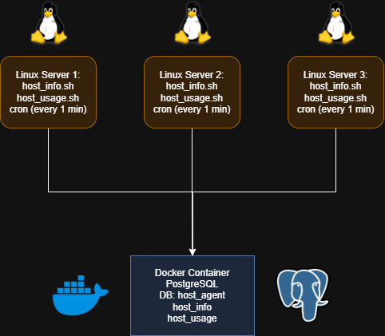

# Introduction

The Linux Cluster Monitoring Agent helps an infrastructure team keep an eye on the hardware and resource usage of several Linux servers from a single place. Each server runs two small Bash scripts. One records the machine's hardware specifications (CPU count, architecture, model, clock speed, L2 cache, total memory) a single time. The other runs every minute through `cron` and records free memory, CPU idle and kernel time, disk I/O, and available disk space. Everything is stored in a PostgreSQL database that runs in a Docker container. The collected history makes it easier to spot machines that are running low on resources and compare hosts. The project is built with Bash, Docker, PostgreSQL, `cron`, and Git/GitHub, and it relies on Linux tools such as `lscpu`, `vmstat`, and `df`.

# Table of Contents
- [Quick Start](#quick-start)
- [Implementation](#implementation)
    - [Architecture](#architecture)
    - [Scripts](#scripts)
    - [Database Modeling](#database-modeling)
- [Testing](#testing)
- [Deployment](#deployment)
- [Future Improvements](#future-improvements)

# Quick Start

Run these from the `linux_sql` directory. Replace the placeholder user and password with your own.

```bash
# 1. Create the PostgreSQL container (for the first time only), then start/stop it as needed.
./scripts/psql_docker.sh create <db_username> <db_password>
./scripts/psql_docker.sh start

# 2. Create the database (for the first time only) and the tables.
psql -h localhost -U <db_username> -c "CREATE DATABASE host_agent;"
psql -h localhost -U <db_username> -d host_agent -f sql/ddl.sql

# 3. Insert this host's hardware specs (run once per host).
bash scripts/host_info.sh localhost 5432 host_agent <db_username> <db_password>

# 4. Insert one usage data point (to test the script before automation).
bash scripts/host_usage.sh localhost 5432 host_agent <db_username> <db_password>

# 5. Collect usage data every minute with crontab (automation)
crontab -e
# Add this line, using the absolute path to your script:
# * * * * * bash /absolute/path/to/linux_sql/scripts/host_usage.sh localhost 5432 host_agent <db_username> <db_password> > /tmp/host_usage.log 2>&1
crontab -l # Confirm that the job is listed
```

# Implementation

Every monitored host runs the scripts, which connect to one shared PostgreSQL instance and insert rows into it. The database stores information for the whole cluster.

## Architecture



The cluster consists of three Linux servers and one database server. Each host runs the scripts, and `host_usage.sh` is triggered every minute by `cron`. All servers send their data over the network to the PostgreSQL container, which stores it in the `host_agent` database.

## Scripts

**`psql_docker.sh`** manages the PostgreSQL container. It creates a container backed by a Docker volume (so data persists even if the container is removed) and starts or stops it. It also checks that Docker is running and that the container exists before starting or stopping it.

```bash
./scripts/psql_docker.sh create|start|stop [db_username] [db_password]
```

**`host_info.sh`** collects the host's hardware specifications with `lscpu` and `/proc`, then inserts them into `host_info`. Hardware is assumed to not change, so it runs once per host.

```bash
bash scripts/host_info.sh psql_host psql_port db_name psql_user psql_password
```

**`host_usage.sh`** collects current resource usage with `vmstat` and `df`, then inserts a row into `host_usage`. It finds the host's `id` by looking up its hostname in `host_info`, so `host_info.sh` must be run first.

```bash
bash scripts/host_usage.sh psql_host psql_port db_name psql_user psql_password
```

**`crontab`** runs `host_usage.sh` every minute so data is collected automatically.

```bash
* * * * * bash /absolute/path/to/scripts/host_usage.sh localhost 5432 host_agent <db_username> <db_password> > /tmp/host_usage.log 2>&1
```

**`ddl.sql`** creates the `host_info` and `host_usage` tables if they do not already exist.

```bash
psql -h localhost -U <db_username> -d host_agent -f sql/ddl.sql
```

## Database Modeling

**`host_info`** stores one row per host with its hardware details.

| Column | Type | Description |
|---|---|---|
| `id` | serial | Primary key, generated automatically |
| `hostname` | varchar | Full hostname, unique |
| `cpu_number` | int2 | Number of CPUs |
| `cpu_architecture` | varchar | CPU architecture, e.g. x86_64 |
| `cpu_model` | varchar | CPU model name |
| `cpu_mhz` | float8 | CPU clock speed in MHz |
| `l2_cache` | int4 | L2 cache size in kB |
| `timestamp` | timestamp | When the specs were collected (UTC) |
| `total_mem` | int4 | Total memory in kB |

**`host_usage`** stores one row per host per minute.

| Column | Type | Description |
|---|---|---|
| `timestamp` | timestamp | When the data was collected (UTC) |
| `host_id` | int | Foreign key referencing `host_info(id)` |
| `memory_free` | int4 | Free memory in MB |
| `cpu_idle` | int2 | CPU idle time, in percent |
| `cpu_kernel` | int2 | CPU time spent in the kernel, in percent |
| `disk_io` | int4 | Number of disk I/O operations in progress |
| `disk_available` | int4 | Available space on the root directory, in MB |

# Testing

Each piece was tested on its own before combining them. The error paths of `psql_docker.sh` (missing arguments, starting a container that does not exist, creating one that already exists) were checked first, followed by create, stop, and start. `ddl.sql` was run against a database that already had the tables (to confirm `IF NOT EXISTS` skips them) and against a fresh one after dropping the tables. Then, `host_info.sh` and `host_usage.sh` were run manually and both tables were queried to confirm the values were sensible, meaning the timestamps were in UTC, memory and disk figures matched the machine, and `host_id` resolved correctly. Lastly, `host_usage` was observed to make sure it gains a new row each minute once the cron job was installed. All tests passed.

# Deployment

The code is hosted on GitHub and followed GitFlow, so it was developed on feature branches that are merged into `develop`, with release pull requests into `main`. PostgreSQL runs in a Docker container created by `psql_docker.sh`, with a volume for persistent storage. The scripts (agent) are installed on the host by cloning the repository, running `host_info.sh` once, and adding the `host_usage.sh` command to `crontab` so it runs every minute.

# Future Improvements

- Create a single setup script that runs the others in order, which would make the agent easier to install
- Handle hardware changes, such as added memory or CPUs, by updating the `host_info` row instead of failing on the unique hostname.
- Report current CPU usage rather than an average since boot.
- Avoid putting the database password in the crontab line by reading it from a protected file or environment variable.
- Add alerting when a host stops reporting or runs low on memory or disk space.
- Write SQL queries to analyze the collected data, such as average memory use per host over time.
